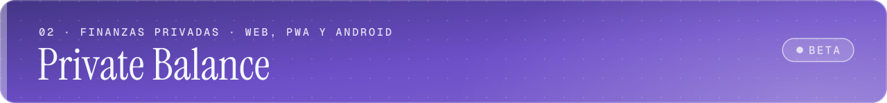
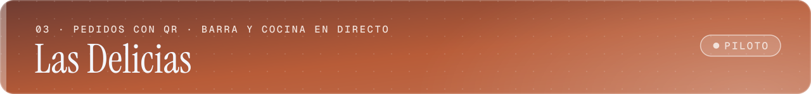
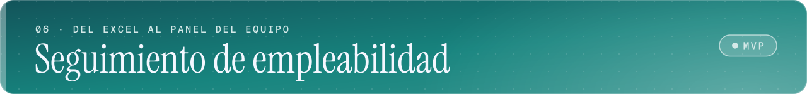

  <a href="https://www.orpira.es"><strong>Portfolio · orpira.es</strong></a>
  &nbsp;·&nbsp;
  <a href="#proyectos">Proyectos</a>
  &nbsp;·&nbsp;
  <a href="https://www.linkedin.com/in/orpira">LinkedIn</a>

Soy **Orlando Pineda Raad**. En [orpira.es](https://www.orpira.es) cuento qué construyo y para quién; aquí está el código que lo demuestra. Cada proyecto enlaza a su app, a su repositorio y a su caso de estudio.

Vengo de coordinar el área de TI de una operación logística, así que programo pensando en quien va a usar la herramienta a diario y en quien tendrá que mantenerla después.

## 3 · Proyectos

Control horario y liquidación de horas extra para una operación logística con turnos rotativos. El kiosko de fichaje sigue funcionando sin conexión.

  
  
  
  
  
  
  

**[Abrir la app →](https://inout.orpira.es/)** &nbsp;·&nbsp; [Repositorio](https://github.com/Orpira/Inout) &nbsp;·&nbsp; [Caso de estudio](https://www.orpira.es/casos/inout)

 

Gestión financiera personal y profesional que mantiene los datos en el dispositivo. Una sola base de código para web, PWA y Android.

  
  
  
  
  
  
  

**[Abrir la app →](https://private-balance.orpira.es/)** &nbsp;·&nbsp; [Repositorio](https://github.com/Orpira/finance-app) &nbsp;·&nbsp; [Caso de estudio](https://www.orpira.es/casos/private-balance)

 

Pedidos desde la mesa con QR, encargos para recoger y pantallas en directo para la barra y la cocina de una cafetería panadería.

  
  
  
  
  
  
  
  

**[Abrir la app →](https://lasdelicias.orpira.es/)** &nbsp;·&nbsp; [Repositorio](https://github.com/Orpira/lasdelicias) &nbsp;·&nbsp; [Caso de estudio](https://www.orpira.es/casos/las-delicias)

 

Práctica de desarrollo web con retos de código, incidencias reales para depurar y laboratorios de SQL y Git.

  
  
  
  
  
  

**[Abrir la app →](https://webwiz.orpira.es/)** &nbsp;·&nbsp; [Repositorio](https://github.com/Orpira/test_interactivo-supabase) &nbsp;·&nbsp; [Caso de estudio](https://www.orpira.es/casos/webwiz)

 

Cinco juegos multijugador para el navegador, con salas con código, turnos y ranking. El Dominó 3D, a cuatro jugadores contra bots o en línea, es el más ambicioso.

  
  
  
  

**[Jugar al Dominó 3D →](https://domino-3d.orpira.es/)** &nbsp;·&nbsp; [Suite de juegos](https://suite-juegos.orpira.es/juegos) &nbsp;·&nbsp; [Repositorio de la suite](https://github.com/Orpira/Cleta-s-stop) &nbsp;·&nbsp; [Caso de estudio](https://www.orpira.es/casos/juegos)

 

Sustituye los Excel con los que una entidad de empleo sigue las candidaturas de sus aspirantes, e importa los antiguos.

  
  
  
  
  

**[Caso de estudio →](https://www.orpira.es/casos/seguimiento-empleabilidad)** &nbsp;·&nbsp; [Demo con acceso por invitación](https://laboratorio.orpira.es/) &nbsp;·&nbsp; código privado

 

**También:** [PRL Master](https://www.orpira.es/casos/prl-master) ([repositorio](https://github.com/Orpira/test_interactivo-prl)) y el [portfolio](https://github.com/Orpira/orpira-portfolio), hecho con Astro y Tailwind CSS.

## 3.1 · Stack en uso

Solo lo que está en el código de los repositorios anteriores.

| Categoría | Tecnologías |
| --- | --- |
| **Frontend** |       |
| **Backend** |    |
| **Bases de datos** |     |
| **Aplicaciones móviles** |   |
| **Infraestructura y DevOps** |     |
| **Testing y herramientas** |      |
| **IA aplicada** |   |

## 3.14 · Qué rastro deja cada fase

**Análisis → Arquitectura → Desarrollo → Validación → Entrega**

Cada fase deja algo en el repositorio que se puede abrir.

| Fase | Qué queda en el repositorio |
| --- | --- |
| **Análisis** | Las reglas escritas en lenguaje de negocio antes que en código, como [las de liquidación de Inout](https://github.com/Orpira/Inout/blob/main/docs/reglas-liquidacion.md). |
| **Arquitectura** | Documentos de decisión numerados, como los de [Private Balance](https://github.com/Orpira/finance-app/tree/main/docs). |
| **Desarrollo** | Migraciones versionadas que permiten reconstruir el producto paso a paso, como las de [Las Delicias](https://github.com/Orpira/lasdelicias/tree/main/server/migrations). |
| **Validación** | Comprobación de tipos y pruebas antes de cada subida y en cada cambio, con [Lefthook](https://github.com/Orpira/finance-app/blob/main/lefthook.yml) y GitHub Actions. |
| **Entrega** | Cada proyecto tiene una dirección pública donde probarlo. |

<strong>Para quien quiera ver el código: cinco decisiones que se pueden comprobar</strong>

 

Cinco criterios que repito de un proyecto a otro, cada uno con el archivo donde se ve.

- **Las reglas de negocio no dependen de nada.** En Inout, el cálculo de horas extra, festivos y parámetros legales es un paquete TypeScript sin dependencias que comparten el servidor y el cliente: [`packages/core`](https://github.com/Orpira/Inout/tree/main/packages/core/src).
- **Lo que depende de la fecha se prueba en varias zonas horarias.** Inout se desarrolla en España y se usa en Colombia, así que la integración continua ejecuta las pruebas en UTC, Madrid y Bogotá contra un PostgreSQL real: [`ci.yml`](https://github.com/Orpira/Inout/blob/main/.github/workflows/ci.yml).
- **Los datos viven donde menos riesgo corren.** Private Balance guarda todo en el dispositivo, y su esquema local ya va por la versión 37, cada una con su migración: [`db.ts`](https://github.com/Orpira/finance-app/blob/main/src/database/db.ts).
- **El tiempo real sale de la base de datos, no de un servicio aparte.** En Las Delicias, PostgreSQL avisa de cada pedido y un único bus lo reparte al panel del local, al cliente y a las automatizaciones, con cada aviso firmado: [`eventos.js`](https://github.com/Orpira/lasdelicias/blob/main/server/src/eventos.js) y [`firma.js`](https://github.com/Orpira/lasdelicias/blob/main/server/src/firma.js).
- **La IA entra con límites.** En WebWiz, la clave de Claude solo existe en el servidor y las correcciones tienen un tope diario: [`explain-review`](https://github.com/Orpira/test_interactivo-supabase/tree/main/supabase/functions/explain-review).

## 3.141 · Contacto

- **Portfolio:** [www.orpira.es](https://www.orpira.es)
- **LinkedIn:** [linkedin.com/in/orpira](https://www.linkedin.com/in/orpira)
- **GitHub:** [github.com/Orpira](https://github.com/Orpira)

   
   
  OrPiRa · Tecnología con visión de negocio · Bilbao Las secciones se numeran con los decimales de π.

